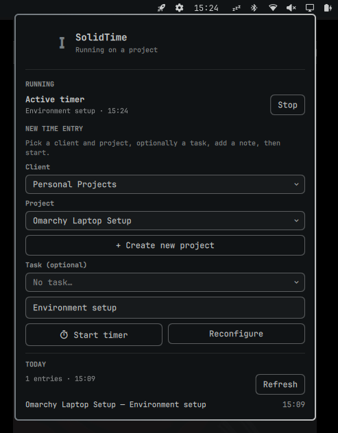

# OmASolid

Track time on a self-hosted [SolidTime](https://github.com/solidtime-io/solidtime) instance from the Omarchy bar.



OmASolid adds a single bar widget that opens a panel for:

- **Running timer** — start a running timer with a client, project, optional task, and a note; stop it with one click. The bar icon shows the live elapsed clock while a timer runs, and the panel keeps ticking in the background.
- **Client + project picker** — clients and projects are pulled live from your SolidTime instance. Pick a client to filter its projects, then pick a project. Tasks are offered when the instance exposes them.
- **Today's entries** — see the day's entries with project, description, and duration, plus the running total.
- **On-screen settings** — enter your instance URL and API token, validate them against the instance, pick the organization, and save — all without touching a config file.

Right-click the bar icon to stop a running timer without opening the panel.

## Install

```sh
omarchy plugin add https://github.com/ksolomon/omasolid.git --enable
omarchy restart shell
```

Add it to the bar explicitly if it is not already there:

```sh
omarchy bar plugin add ksolomon.omasolid --section right
```

## Configure

1. Open the widget in the bar and enter your SolidTime **instance URL** (e.g. `https://solidtime.example.com`) and an **API token**.
2. Click **Validate & load**. The helper authenticates and lists the organizations your token can access.
3. Choose the **organization** you want to track time in and click **Save & connect**. The member id for that organization is stored automatically.

The configuration is persisted to `~/.config/omarchy/solidtime.json` with `0600` permissions, because it contains your bearer token. To reconfigure later, open the panel and click **Reconfigure**.

### Creating an API token

In SolidTime, generate a personal API token from **Profile Settings → Create API Token** and copy it. The token is only shown once. For self-hosted instances you may first need to create an OAuth client for user API tokens — see the SolidTime self-hosting guide.

## How it works

The plugin follows the standard Omarchy plugin shape: a `Service.qml` coordinates a small Python helper (`solidtime.py`) over `Process`, and the helper does all HTTP against the SolidTime REST API using only the Python standard library — no pip dependencies. The bar widget and panel read state from the service. The live elapsed timer ticks inside QML and resyncs from the API every minute so it stays accurate even after the panel closes.

The helper stores config at `~/.config/omarchy/solidtime.json` and exposes these subcommands to the service: `init`, `save-config`, `test-config`, `memberships`, `projects`, `active`, `start`, `stop`, and `today`.

## Requirements

- Omarchy (Quattro or later)
- Python 3
- A reachable self-hosted SolidTime instance with an API token

## Validate

```sh
omarchy plugin validate .
python3 solidtime.py init
```

## Remove

```sh
omarchy plugin remove ksolomon.omasolid
rm -f ~/.config/omarchy/solidtime.json
```

## License

MIT
